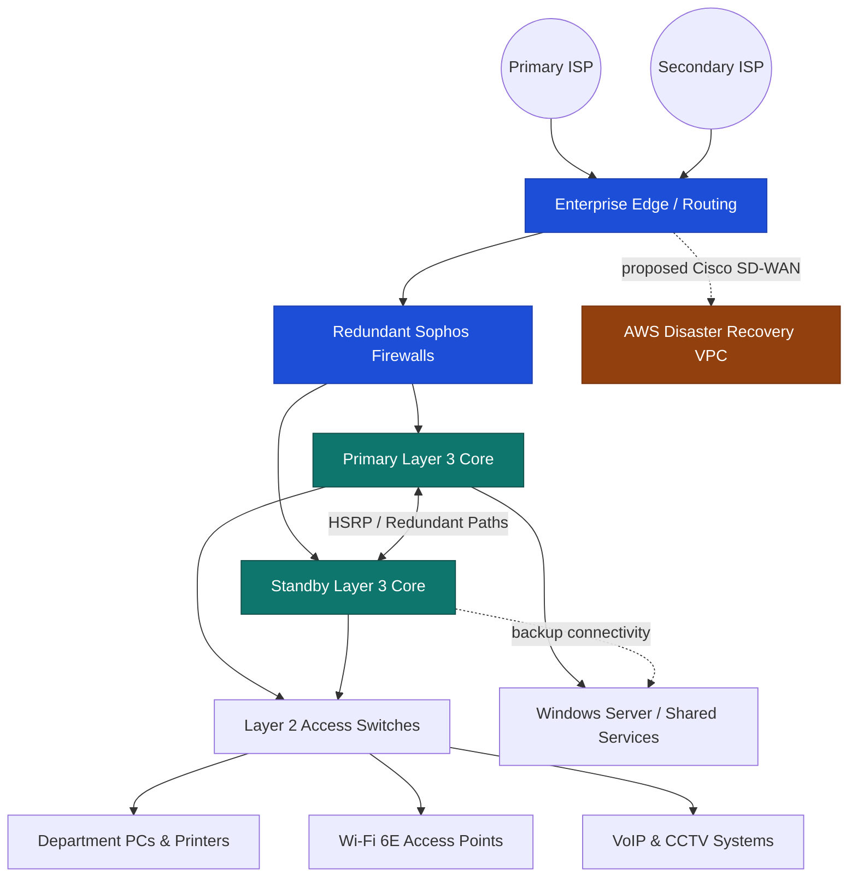

# HND-Final-Project

# 🌐 NextEdge Head Office | Enterprise Network Design & Implementation

**A network engineering case study combining resilient Cisco infrastructure, layered security, server services, and an AWS cloud proof of concept.**

**[Overview](#-project-overview) • [Architecture](#-network-architecture) • [Technologies](#-technologies--protocols) • [Implementation](#-implementation-highlights) • [Testing](#-verification--results) • [Team](#-project-team)**

---

## 📖 Project Overview

This project presents the **design and lab-scale implementation of an enterprise network infrastructure for NextEdge (Pvt) Ltd's new head office in Colombo 3, Sri Lanka**. It was developed in **2026** as a group project for the **Higher National Diploma in Network Engineering** at the **National Institute of Business Management (NIBM), School of Computing**.

The proposed architecture brings together a hierarchical Cisco network, departmental VLANs, redundant gateways, secure wired and wireless access, Windows Server services, voice and surveillance systems, and a planned AWS disaster recovery (DR) environment. A scaled-down physical/virtual lab and an AWS deployment were used to demonstrate selected technologies.

> [!NOTE]
> **Academic proof of concept, not a production rollout.** The complete multi-floor network, enterprise firewall/wireless estate, Cisco SD-WAN overlay, and AWS DR architecture are **proposed designs**. The lab tests and EC2/VPC deployment described below are the **documented hands-on implementations**. This distinction is important when interpreting the diagrams and results.

## 🎯 Objectives

- **Availability:** Improve fault tolerance through HSRP, redundant links, STP, and a resilient edge design.
- **Security:** Segment departments with VLANs, ACLs, port security, and restricted SSH management.
- **Scalability:** Design for multiple floors, departments, servers, wireless clients, and future growth.
- **Performance:** Organize inter-VLAN traffic and use EtherChannel to improve uplink capacity and resilience.
- **Cloud integration:** Demonstrate AWS-hosted services and design an extended cloud DR strategy.
- **Manageability:** Document addressing, network topology, infrastructure components, and validation results.

## 🏗️ Network Architecture

The proposed design follows a **hierarchical core/distribution/access architecture** with redundant perimeter security, a Layer 3 gateway pair, and departmental access networks. AWS-based business continuity is included as a **separate proposed DR extension**.

*Conceptual design only; the lab proof of concept uses a smaller topology. The dotted AWS link represents the proposed SD-WAN/DR integration, not a verified live tunnel.*

### Physical & wireless design

The project report includes:

- Floor plans and network layouts covering the **ground through fifth floors**.
- Hierarchical and logical network diagrams, device roles, and rack layouts.
- Wireless coverage planning for **2.4 GHz, 5 GHz, and 6 GHz** bands.
- A policy to **exclude the isolated fifth-floor R&D lab from general Wi-Fi access**.
- A planned enterprise platform using Cisco Catalyst switches, Cisco Meraki access points, and Sophos firewalls.

## 🧰 Technologies & Protocols

| Area | Technologies | Purpose |
| --- | --- | --- |
| Network segmentation | **VLANs, trunking, VTP** | Separate departments and distribute VLAN information |
| Redundancy & switching | **HSRP, STP, EtherChannel** | Gateway failover, loop prevention, resilient switch uplinks |
| Routing | **OSPF, inter-VLAN routing, static/default routes** | Connectivity between subnets and toward the network edge |
| Internet connectivity | **NAT, PAT** | Outbound connectivity through translated addresses |
| Security & management | **ACLs, port security, SSH, pfSense** | Enforce traffic policies and protect administrative access |
| Network services | **DHCP, DNS, AD DS** | Address allocation, name resolution, and identity services |
| Server environment | **Windows Server 2019 VM** | Lab-based server and network service configuration |
| AWS cloud PoC | **EC2, VPC, subnets, route tables, IGW, security groups, NACLs, DNS** | Deploy and validate cloud-hosted workloads |
| Proposed enterprise DR | **AWS DRS, Aurora, S3, Route 53, Cisco SD-WAN** | Design for replication, recovery, and resilient cloud connectivity |

## 🧩 VLAN & IP Addressing Examples

Selected entries from the **full-scale design addressing plan**:

| Department / Usage | VLAN | Network |
| --- | ---: | --- |
| Inventory Management | 10 | `172.16.6.0/25` |
| Customer Service | 13 | `172.16.6.128/25` |
| Call Centre | 16 | `172.16.4.0/24` |
| Management | 19 | `172.16.7.0/25` |
| Finance | 22 | `172.16.9.128/26` |
| Human Resources | 25 | `172.16.11.64/28` |
| Isolated R&D Lab | 34 | `172.16.10.0/26` |
| Server Management | 43 | `192.168.1.0/29` |

> [!IMPORTANT]
> These are **selected design values**, not a ready-to-deploy configuration. The lab uses some different subnet assignments to fit its representative topology. Check the report's design and lab tables independently before reusing IP addresses or policies.

## ⚙️ Implementation Highlights

<b>🔀 Cisco Layer 3 switching & routing</b>

The lab implementation included a main/standby Layer 3 switch pair, **HSRP gateway redundancy**, routed connectivity, OSPF, default routes, and EtherChannel-based uplinks. Testing checked gateway failover and continued forwarding when an aggregated link member was disconnected.

<b>🖧 Layer 2 switching & perimeter controls</b>

Representative access switches were configured for VLAN membership, trunk connections, secure administration, and port security. A pfSense firewall was also configured in the lab environment. ACLs enforced management-access restrictions and limited internet connectivity for the isolated Lab network.

<b>🪟 Windows Server infrastructure</b>

A **Windows Server 2019 virtual machine** was used for server-side services, including DHCP, DNS, and Active Directory Domain Services. DHCP tests covered representative Inventory Management, HR, and Lab segments.

<b>☁️ AWS cloud implementation — my primary contribution</b>

My primary responsibility was the **AWS infrastructure proof of concept**. The documented work included:

- Configuring the **AWS VPC**, subnets, route tables, Internet Gateway, security groups, network ACLs, and DNS-related settings.
- Deploying and managing the **`NextEdgeMSP` EC2 instance** for the project website.
- Verifying website access through the instance's **public IPv4 address, EC2 public DNS, and configured DuckDNS hostname**.
- Deploying a second EC2 instance, **`nextedge_backup_fileserver`**, to represent the cloud backup-server workload.
- Checking EC2 instance status and the accessibility of the deployed cloud services.

These items are supported by the AWS implementation screenshots in **Chapter 7, pages 75–79** of the project report. They should not be confused with proof that the entire proposed DR/SD-WAN platform was deployed or failover-tested.

<b>🛡️ Proposed disaster recovery & enterprise security</b>

The full design extends the head office to an **AWS warm-standby DR environment** and describes AWS Elastic Disaster Recovery, Aurora Global Database, S3 replication, Route 53 DNS failover, and encrypted dual-ISP Cisco SD-WAN connectivity. It also plans a redundant Sophos firewall perimeter, enterprise Wi-Fi controls, surveillance, and physical access restrictions.

**Status:** These are architectural design elements; the report's concrete AWS implementation evidence covers EC2 web/backup workloads and VPC resources.

## 🧪 Verification & Results

The report records the following **lab and cloud PoC checks**:

| Component | Documented verification |
| --- | --- |
| **HSRP** | Gateway takeover observed when the active path was interrupted |
| **DHCP** | Address allocation verified for representative VLANs |
| **SSH** | Device management permitted from the authorized admin subnet and denied elsewhere |
| **PAT / Lab isolation** | General internet egress worked while Lab traffic to the internet was blocked |
| **ACLs** | Selected HR/Lab and management access restrictions behaved as intended |
| **EtherChannel** | Traffic continued when one bundled uplink member was disabled |
| **Port security** | Unauthorized MAC-address access triggered the configured protection behavior |
| **AWS EC2 / VPC** | Both EC2 workloads were shown running; the hosted website was reachable through tested endpoints |

**Evaluation scope:** Results come from the academic PoC and its supporting screenshots. They are **not** production uptime, cloud disaster recovery, or enterprise-scale performance benchmarks.

## 📚 Project Documentation

The **97-page final project report** contains requirements, threat modeling, architectural design, VLAN/IP tables, Wi-Fi heat maps, rack diagrams, equipment choices, configuration evidence, cloud screenshots, and evaluation results.

**Suggested repository location:** `docs/NextEdge_Project_Report.pdf` — add the report there if you would like visitors to read it. The README does not assume this file has already been uploaded.

<b>📑 Report chapter guide</b>

1. **Project Brief & Business Case** — background, objectives, and project scope.
2. **Requirements Specification** — functional, non-functional, and stakeholder requirements.
3. **Security Requirements Specification** — threat model, controls, and compliance considerations.
4. **System Design and Architecture** — topology, wireless planning, VLANs, DR design, and budget.
5. **Reliability and Assurance Plan** — failover, backup, and monitoring strategy.
6. **Implementation Plan** — milestones, tools, and assigned responsibilities.
7. **Implementation** — Cisco/pfSense/Windows lab work and AWS screenshots.
8. **Evaluation, Results & Testing** — configuration checks and observed results.
9. **Conclusion & Future Improvements** — lessons learned and recommendations.

## 🚀 How to Explore This Project

1. Read the **overview and architecture** to understand the intended enterprise design.
2. Review the **protocols and VLAN table** for the network approach.
3. Open **Implementation Highlights** to distinguish the lab work from the AWS PoC.
4. Compare the **Verification & Results** section with Chapter 8 of the report.
5. Use the original report for full topology diagrams, device settings, and supporting screenshots.

> [!TIP]
> If you publish configurations or AWS screenshots, remove credentials, private keys, account IDs, and any sensitive infrastructure details before committing them to GitHub.

## 👥 Project Team

| Member | Primary contribution |
| --- | --- |
| **G. W. J. K. Bhashana — Group Leader** | Coordination, Layer 2 switching, pfSense, physical lab integration |
| **D. T. P. Ladduwahetti** | AWS cloud implementation, EC2 web/backup workloads, VPC networking, cloud validation |
| **R. M. C. D. Rathnayaka** | Windows Server, Active Directory, DHCP, DNS, server connectivity |

**Academic supervisor:** Mr. Niranga Dharmarathna  
**Institution:** National Institute of Business Management (NIBM) — School of Computing  
**Program:** Higher National Diploma in Network Engineering  
**Year:** 2026

## 📄 License & Usage

This repository documents an **academic group project**. The report does not specify an open-source software license. Add a `LICENSE` file if you decide to release reusable project material and confirm permission to share third-party assets or configurations.

---

### ✨ Engineering secure, reliable & cloud-ready networks

Enterprise Network Design • AWS Cloud PoC • NIBM • 2026

